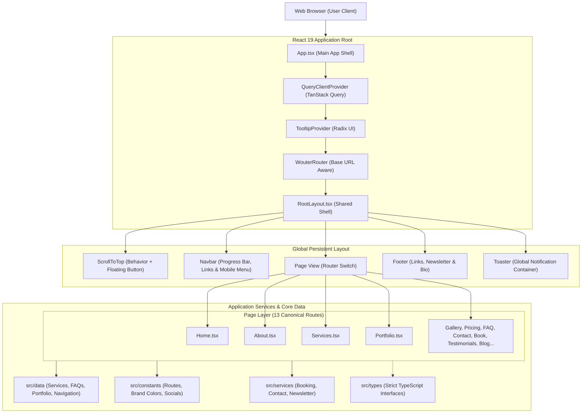

# Sushma Digital Studio — System Architecture Documentation

This document explains the architectural principles, component communication patterns, and technical design decisions powering the Sushma Digital Studio web application.

---

## 🏗 High-Level Architecture Overview

---

## ⚙️ Core Technology Decisions

### 1. Vite 7 + React 19 Single Page Application (SPA)
- **Why SPA:** Instant, buttery-smooth client-side transitions, cinematic hero animations, and persistent interactive state (e.g. portfolio lightbox, audio/video playback, and sticky navigation) without full-page reloads.
- **Vite 7:** Delivers instant Hot Module Replacement (HMR) during local development and highly-optimized Rollup bundling with tree-shaking for production.

### 2. Client-Side Routing via Wouter
- `wouter` is a micro-router (under 2KB) compared to React Router (over 15KB).
- It handles route matching via standard browser History API.
- Configured with `import.meta.env.BASE_URL` in `App.tsx` to cleanly handle subpath hosting on GitHub Pages (`/sushma_digital/`) as well as root-level custom domain hosting (`sushmadigitalstudio.com`).

### 3. Tailwind CSS v4 Engine
- Driven directly by `@tailwindcss/vite`.
- Uses modern `@theme inline` CSS custom properties for instant styling token resolution.
- Enforces strict design palette consistency without extraneous configuration files.

### 4. Headless & Accessible UI via Radix Primitives
- Used for accordions, dialogs, tooltips, and sheet drawers.
- Handles full ARIA accessibility, keyboard navigation, and focus management automatically.

---

## 🔄 Data Flow & State Management

1. **Static Data Decoupling:**
   - Datasets that do not require runtime mutations (services, pricing tiers, FAQs, portfolio metadata, blog posts) are decoupled from UI components and stored in `src/data/`.
   - Pages simply consume these pure data arrays, making the application extremely easy to update without touching JSX/TSX layout code.
2. **Runtime Form State:**
   - Handled via `react-hook-form` paired with `zod` for robust schema validation.
   - Form submission handlers delegate to `src/services/` (`bookingService`, `contactService`), decoupling UI components from network calls or external protocol handlers (e.g., WhatsApp deep linking).
3. **Scroll & Page Transitions:**
   - Route transitions use Framer Motion's `PageTransition` and `FadeIn` components.
   - `ScrollToTop` monitors `wouter`'s location state and resets window scroll on navigation while providing a floating return-to-top button at deep scroll depths.

---

## 🌐 Technical SEO & Discovery Pipeline

1. **Runtime Meta Tags via `<SEO />`:**
   - Every page mounts `src/components/common/SEO.tsx`.
   - Dynamically updates `<title>`, `<meta name="description">`, OpenGraph tags, Twitter Cards, and canonical links.
2. **Crawler Directives (`public/robots.txt`):**
   - Allows search engines unrestricted access to public pages, styles, and assets.
   - Declares the location of the canonical XML sitemap.
3. **XML Sitemap (`public/sitemap.xml`):**
   - Strictly conforms to the `sitemaps.org/schemas/sitemap/0.9` standard.
   - Exactly reflects all 13 authentic canonical routes with priority and change frequency indicators.
4. **Structured Data (Schema.org):**
   - `index.html` embeds JSON-LD `PhotographyStudio` metadata specifying founder Prabhu, awards (`Karnataka Chayarathna`), contact telephone, and operating geolocation in Bangalore.

---

## 🚀 CI/CD & Deployment Strategy

- **Repository:** GitHub (`main` branch).
- **Automation:** GitHub Actions workflow at `.github/workflows/deploy.yml`.
- **Build Step:** `pnpm run build` generates static assets in `dist/public`.
- **Hosting Target:** GitHub Pages with custom domain binding (`sushmadigitalstudio.com`).
- **SPA Fallback:** The workflow automatically copies `index.html` to `404.html` in `dist/public`, ensuring that direct navigation or refreshes to any client-side route (`/services`, `/portfolio`, `/about`) are smoothly served without HTTP 404 errors.
